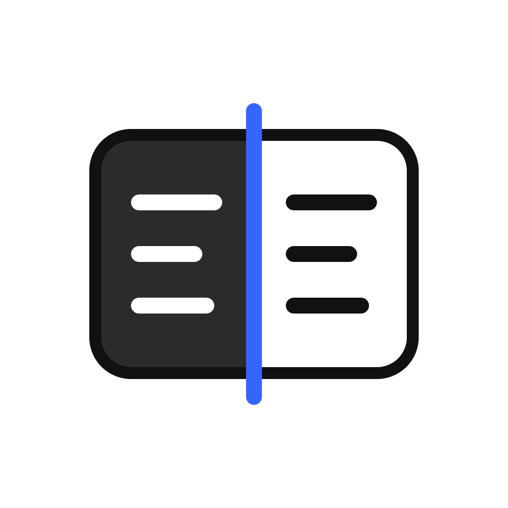
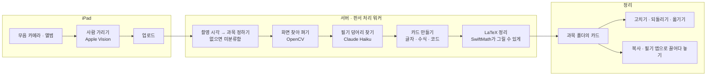
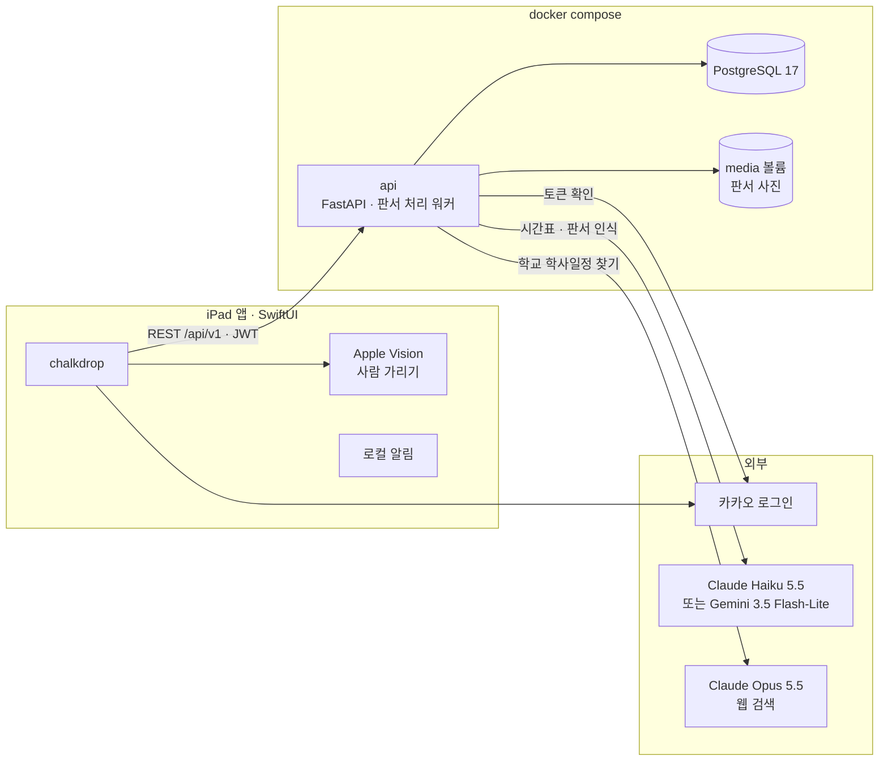

<p align="center">
  
</p>

# chalkdrop

**찍고, 끌어서, 노트에 놓으세요.**
수업 중에 찍은 판서 사진을 시간표에 맞춰 과목별로 나누고, AI로 글자 · 수식 · 코드 카드로 바꿔 주는 iPad 앱입니다.
2026 경북대학교 컴퓨터학부 해커톤(주제: 컴퓨터학부 학생에게 필요한 서비스) 출품작입니다.


| API 문서 (로컬) |
| --- |
| http://localhost:8000/docs |

## 무엇을 해결하나요

- 컴퓨터학부 수업은 수식 · 코드 · 도식이 칠판에 빠르게 지나갑니다. 사진으로 찍어 두지만 사진첩에 다른 사진과 섞이고, 어느 과목 몇 주차 판서인지 나중에 찾기 어렵습니다.
- chalkdrop은 시간표를 한 번 등록해 두면 찍은 시각으로 과목을 정해 폴더에 넣고, 사진 속 판서를 글자 · 수식(LaTeX) · 코드 카드로 바꿔 필기 앱에 바로 붙여 넣을 수 있게 합니다.
- 사진에 찍힌 사람(교수님 · 앞줄 학생)은 올리기 전에 iPad 안에서 가립니다. 사람이 보이는 원본은 서버와 AI로 나가지 않습니다.

## 주요 기능

| 구간 | 기능 |
| --- | --- |
| **시작** | 카카오 · 이메일 로그인 · 학교 선택 · 에브리타임 시간표 캡처를 AI로 읽어 과목 자동 등록 · 학기 여러 개 관리 |
| **수업 중** | 셔터음 없는 무음 카메라 · 사진 앨범에서 올리기 · 올리기 전 기기 안에서 사람 가리기(Apple Vision) · 촬영 시각에 맞는 과목 폴더로 자동 분류, 맞는 수업이 없으면 미분류함 |
| **판서 처리** | 화면 찾아 펴기(OpenCV) → 필기 덩어리 찾기(AI) → 글자 · 수식 · 코드 카드 만들기 · 단계별 진행 화면 · 실패하면 다시 시도 |
| **정리** | 카드 고치기 · 되돌리기 · 다른 과목으로 옮기기 · 미분류함 정리 · 카드 복사(수식은 그림으로) · 붙여넣기 색 골라 필기 앱으로 끌어다 놓기 |
| **메인 화면** | 지금 듣는 수업 · 오늘 수업 · 이번 주 판서 · 시험까지 남은 날 (학교 학사일정을 웹 검색으로 찾고, 못 찾으면 추정 개강일 기준 8 · 15주차) |
| **알림** | 판서 찍은 수업이 끝나고 5분 뒤 정리 알림 · 시험 7일 전 · 1일 전 복습 알림 · 미분류 판서가 남은 날 21시 알림 |

판서 한 장은 이렇게 흐릅니다.



판서 처리는 서버 뒤에서 한 장씩 돌고, 단계마다 상태(`uploaded → rectifying → segmenting → interpreting → done`)를 저장해서 앱이 지금 단계를 보여 줍니다. 서버가 처리 중에 꺼져도 다시 켜면 멈춘 판서를 이어서 처리합니다.

## 시스템 구조

개발 환경은 `docker compose` 로 API 서버와 PostgreSQL 두 컨테이너를 띄웁니다. iPad 앱은 REST API로 서버와 통신하고, 서버는 판서 · 시간표 인식과 학사일정 찾기에만 외부 AI를 부릅니다. 찾은 학사일정은 DB에 저장해 같은 학교 사용자가 함께 씁니다.



| 컨테이너 | 이미지 | 역할 |
| --- | --- | --- |
| `api` | 자체 빌드 (Python 3.11) | REST API, 로그인 토큰, 판서 처리 워커, 켤 때 `alembic upgrade head` |
| `db` | `postgres:17` | 사용자 · 학기 · 과목 · 판서 · 카드 · 학사일정 저장 |

| API | 하는 일 |
| --- | --- |
| `/auth` | 카카오 로그인 · 이메일 가입 · 로그인 |
| `/me` | 내 정보 · 알림 설정 |
| `/timetable/parse` | 시간표 캡처를 AI로 읽기 |
| `/semesters` · `/subjects` | 학기 · 시간표 · 과목 관리 |
| `/captures` | 판서 올리기 · 처리 상태 · 다시 시도 · 과목 옮기기 |
| `/cards` | 카드 고치기 · 되돌리기 · 옮기기 · 지우기 |
| `/home` | 메인 화면 정보 (지금 수업 · 오늘 수업 · 시험까지 남은 날) |

## 기술 스택

| 영역 | 기술 |
| --- | --- |
| iPad 앱 | Swift · SwiftUI (일부 UIKit) · AVFoundation(무음 카메라) · Vision · CoreImage(사람 가리기) · PhotosUI · UserNotifications · Keychain · Swift Package Manager |
| 앱 패키지 | Kakao iOS SDK 2.30 (로그인) · SwiftMath 1.7 (수식 그리기) |
| 서버 | Python 3.11 · FastAPI 0.163 · Uvicorn · SQLAlchemy 2.1 · Alembic · psycopg 3 · pydantic-settings · PyJWT · Argon2 · httpx · uv |
| 이미지 처리 | OpenCV 5.1 (headless) · Pillow · NumPy |
| AI | 판서 · 시간표 인식: Anthropic Claude `claude-haiku-5-5` (기본) 또는 Google Gemini `gemini-3.5-flash-lite` (`LLM_PROVIDER=gemini`) · 학사일정 웹 검색: Claude `claude-opus-5-5` |
| DB | PostgreSQL 17 |
| 개발 환경 | Docker Compose · GitHub Actions |
| 품질 도구 | ruff (check · format, line-length 100) · pytest |

## 빠른 시작

**사전 준비** — Docker, Xcode, [uv](https://docs.astral.sh/uv/) (린트 · 로컬 실행용)

```bash
# 서버 → http://localhost:8000/docs
cp .env.example .env      # ANTHROPIC_API_KEY, JWT_SECRET, KAKAO_APP_ID 등
docker compose up         # Postgres + API, 켤 때 alembic upgrade head 자동 실행

# iPad 앱
cp ios/Config/Local.xcconfig.example ios/Config/Local.xcconfig   # 내 Team ID · 번들 ID · 카카오 앱 키
open ios/Pansoham.xcodeproj                                      # iPad 시뮬레이터나 기기를 골라 실행
```

- `./server` 가 컨테이너에 연결되어 있어 코드를 저장하면 서버가 다시 시작됩니다. 의존성을 바꿨을 때만 `docker compose up --build` 로 다시 빌드합니다. DB를 비우려면 `docker compose down -v`.
- AI 키가 없어도 서버는 뜹니다. 시간표 · 판서 인식만 동작하지 않고, 학사일정은 추정 개강일(1학기 3/2 · 2학기 9/1)로 계산합니다.
- 실기기에서 실행할 때는 `Local.xcconfig` 의 `API_BASE_URL` 에 서버를 띄운 Mac 주소(예: `http:/$()/my-macbook.local:8000`)를 적습니다. 시뮬레이터는 `localhost` 를 쓰므로 지웁니다.
- 모든 비밀값은 `.env` · `Local.xcconfig` 에만 두고 커밋하지 않습니다. `.env.example` 에는 이름과 용도만 있습니다.

| 변수 | 용도 |
| --- | --- |
| `ANTHROPIC_API_KEY` | 시간표 · 판서 인식 (기본 AI) · 학사일정 웹 검색 |
| `LLM_PROVIDER`, `GEMINI_API_KEY` | Gemini를 쓸 때 `LLM_PROVIDER=gemini` 와 함께 |
| `JWT_SECRET` | 로그인 토큰 서명 키 (32자 이상 무작위 값) |
| `KAKAO_APP_ID` | 카카오 로그인 |
| `PIPELINE_WORKERS` | 판서를 동시에 몇 장 처리할지 (기본 1) |

## 저장소 구조

```text
.
├── ios/            iPadOS SwiftUI 앱 (Pansoham.xcodeproj)
│   ├── Pansoham/
│   │   ├── App/           진입점 · 화면 이동
│   │   ├── Features/      화면 묶음 — 메인, 촬영, 처리 중, 과목, 미분류함, 카드, 시간표, 학기, 계정
│   │   ├── Core/          카메라 · 사람 가리기 · 네트워크 · 로그인 · 알림 · 클립보드
│   │   └── DesignSystem/  공통 색 · 글꼴 · 수식 표시(MathText)
│   └── Config/            xcconfig (Local.xcconfig는 git에 올리지 않음)
├── server/         FastAPI 백엔드
│   ├── app/
│   │   ├── api/v1/        REST API
│   │   ├── models/        SQLAlchemy 모델
│   │   ├── services/      로그인 · 시간표 · 홈 · 학사일정 · 시험 기간 · AI 연결(Claude · Gemini)
│   │   │   └── pipeline/  판서 처리 — vision(OpenCV) · regions(AI) · latex · worker
│   │   └── storage/       판서 사진 저장
│   ├── alembic/           DB 마이그레이션
│   └── tests/             pytest
├── docs/           설계 문서 자리
├── docker-compose.yml
└── .github/        CI
```

## 개발 규칙

**브랜치** — `main` 에 직접 푸시하지 않습니다. `feat/…` · `fix/…` · `docs/…` 브랜치 → PR → 리뷰 후 머지

**커밋 · PR** — 제목은 conventional commit (`feat:` `fix:` `docs:` `test:` `chore:` `ci:` `refactor:`). 주석과 문서는 한국어로 씁니다.

**명령**

| 할 일 | 명령 |
| --- | --- |
| 린트 | `uvx ruff check .` |
| 포맷 | `uvx ruff format .` |
| 서버 테스트 | `docker compose exec api uv run --no-sync pytest` |
| 마이그레이션 생성 | `docker compose exec api uv run --no-sync alembic revision --autogenerate -m "..."` |

- 서버 테스트는 `pansoham_test` DB를 씁니다. Postgres에 붙지 못하면 DB 테스트를 건너뛰고, `REQUIRE_DB=1` 이면 실패로 처리합니다.
- `server/app/models/` 를 바꿨다면 마이그레이션을 만들고 `server/alembic/versions/` 의 파일을 꼭 검토합니다.

**CI** — `.github/workflows/ci.yml`

| 작업 | 하는 일 |
| --- | --- |
| `lint` | ruff check · ruff format --check |
| `server-test` | Postgres 17 서비스를 띄우고 `uv sync` → `pytest` (`REQUIRE_DB=1` 이라 DB 테스트를 건너뛰지 않음) |

## 팀

2026 경북대학교 컴퓨터학부 해커톤

| 이름 | 맡은 부분 | 대표 작업 |
| --- | --- | --- |
| 김강민 | 서버 · 협업 환경 (BE) | 판서 API · 처리 워커, AI 전환, CI · 협업 규칙 |
| 김택현 | 서버 · 데이터 (BE) | DB 설계, 시간표 인식, 로그인, 카드 · 메인 API |
| 박성해 | 파이프라인 · iOS (FE) | 첫 판서 파이프라인, 화면 · API 연결, 알림 · 카메라 |
| 배한결 | iOS 화면 (FE) | 앱 초기 세팅, 화면 · 애니메이션, 시간표 입력, 촬영 |
| 이민석 | AI 정확도 · 보안 (BE) | 숫자 정렬 블록 추출, 확인 필요 표시, 보안 점검 |
